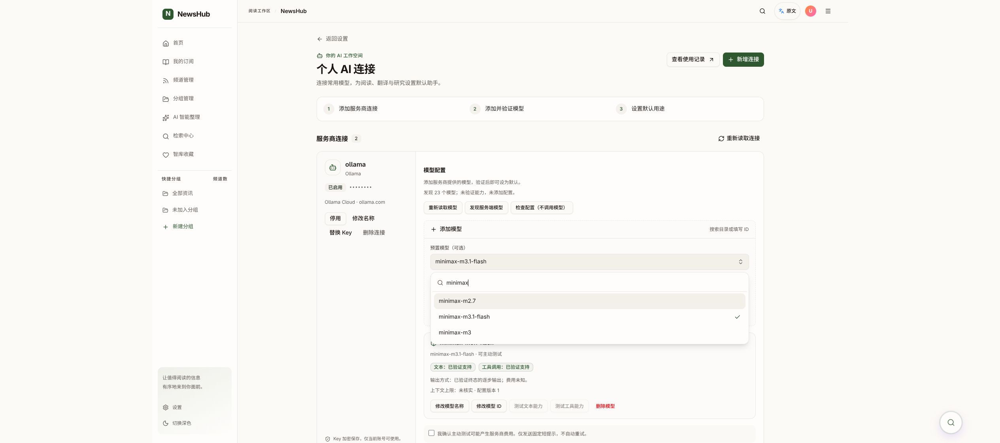

# AI 设置界面与可搜索模型选择器

2026-10-21。本地已更新，等待人工验收；未提交、推送、合并。基于 HEAD 26243ecd347f67cb196afd3996a48501d7911047 的未提交工作树，保留此前 RSS、文章、默认模型与分页记录改动。

## 本次行为

- AI 设置页使用现有 shadcn/ui Button、Input、Card、Badge；模型选择使用 Radix Popover + cmdk Command 的 shadcn 组合方式，新增 model-combobox.tsx 复用。服务商/认证类型仍是样式统一的 NativeSelect。
- 连接卡片分开呈现连接信息与模型管理，启用连接优先。模型验证状态用徽标显示，添加表单与按用途覆盖配置支持展开。
- 添加模型、全局默认模型及四个用途模型全部可搜索名称和 ID。列表限制高度、独立滚动，支持键盘方向键、回车和 Esc，无匹配时明确提示；清空关键词恢复全部选项。
- 过滤使用已加载目录，无额外网络请求或推理。仅显示当前用途可用且通过必要能力验证的模型，失效已保存配置仍明确提示，不静默切换。
- 模型修改或验证后刷新用途可用列表。所有用途跟随默认按钮仅生成草稿，仍需点击保存。
- 阅读场景直接消费默认配置，不恢复模型选择框；使用记录入口仍为独立分页页 /settings/ai/usage。

## 文件

frontend/src/pages/AIModelSettingsPage.tsx、pages/aiConnections.css；components/workspace/AIModelsManager.tsx、AITaskPreferencesSection.tsx；components/ui/model-combobox.tsx、native-select.tsx；frontend/package.json 与 package-lock.json。新增 @radix-ui/react-popover 和 cmdk；工作树使用独立 node_modules，未覆盖原仓库共享依赖。

组件参照：https://ui.shadcn.com/docs/components/radix/combobox 。

## 验证证据

PASS：Node 22 TypeScript、全前端 ESLint、Vite 构建、git diff --check。
PASS：AIModelsManager、AITaskPreferencesSection、AIModelSettingsPage、aiConnectionsApi 四个定向文件，共 40 项。覆盖名称/ID 筛选、清空与无结果、过滤不写入不调用模型、原有 owner/取消/未知结果不重复发送逻辑。
PASS：Chrome 本地页面读取 Ollama 23 个目录项；输入 minimax 后只显示 3 项，方向键/回车完成选择并关闭弹层；未点击添加或修改已保存设置，未发起推理。
NOT_RUN：全套回归、远端 CI、移动端人工验收、真实生成/计费验证。UI 自动检查使用合成接口，不代表真实模型运行证明。

## 人工验收

1. 打开 http://127.0.0.1:9527/settings/ai ，展开添加模型；Ollama 点击发现服务端模型后打开选择器，输入 minimax/kimi 等关键字检查即时筛选，清空恢复列表，随意输入无匹配词检查空状态。
2. 全局默认模型及展开后的用途模型也支持名称/ID 搜索；选中后只有点击保存用途偏好才写入。原有连接和配置仍在。
3. 查看使用记录打开独立分页页；文章阅读仍直接使用已保存默认模型。

## 本地更新与回退

只将新构建资产追加到 /home/lambert/.local/share/newshub/ai-connections-20261021/frontend/assets，并原子替换 index.html；未重建后端或修改数据库。回退时将 /home/lambert/.local/share/newshub/ai-settings-shadcn-20261021/previous-index.html 原子恢复为该 frontend/index.html，保留资产与数据。
