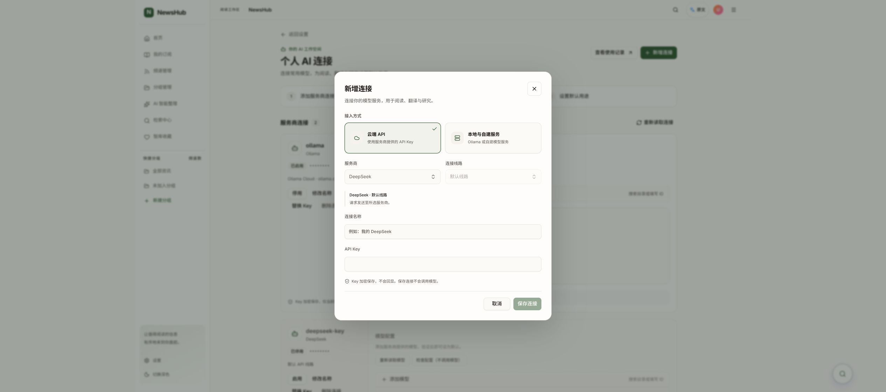
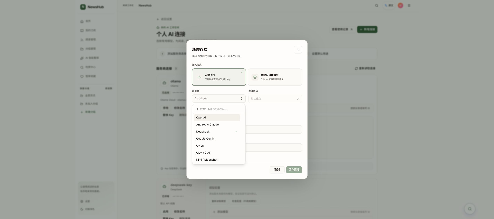

# 新增连接弹窗视觉整理

2026-10-21。本地已更新，未提交推送。工作树 feat/ai-connections-ui-20261021，HEAD/base 26243ecd347f67cb196afd3996a48501d7911047 上的未提交修改，保留已有功能。

## 改动

接入方式改成带图标、说明及选中标识的两张选项卡；服务商与线路并列，名称和 Key 各占一行，统一输入框尺寸、间距和底部按钮。保留原有 shadcn Button/Input 与搜索选择器。

服务商列表去掉重复显示的内部标识，但仍按标识过滤（Command.Item value 保持原 ID）；线路列表不再暴露 profile ID。修复旧 workspace 原生输入框样式污染 Command.Input 导致的嵌套边框和焦点描边，弹窗中的搜索行保持单一、紧凑的外观。状态、键盘、Esc、授权范围、提交/Key 清空逻辑不变。

文件：frontend/src/pages/AIModelSettingsPage.tsx、pages/aiConnections.css、components/ui/model-combobox.tsx。小屏 CSS 将卡片与表单改为单列，未声称移动端人工验收。

## 验证

PASS：AIModelSettingsPage、AIModelsManager、AITaskPreferencesSection 三个定向文件 34 项；TypeScript；定向 ESLint；Vite build；git diff --check。
PASS：Chrome 新增连接弹窗和展开的搜索列表视觉检查，保存两张截图；Esc 关闭列表后保留弹窗。没有输入真实 Key、保存连接或发起推理。
NOT_RUN：移动端/深色模式人工验收、全量 CI、真实模型调用。

人工验收：刷新 /settings/ai → 新增连接；检查接入选项不拥挤，服务商/线路并排；打开服务商选择器检查单行选项和无双重边框的搜索行；输入关键词仍可筛选。取消退出即可，无需保存测试数据。

静态回退：将 /home/lambert/.local/share/newshub/connection-dialog-polish-20261021/previous-index.html 原子恢复到既有 ai-connections-20261021/frontend/index.html。保留构建资产、数据库及凭据。
