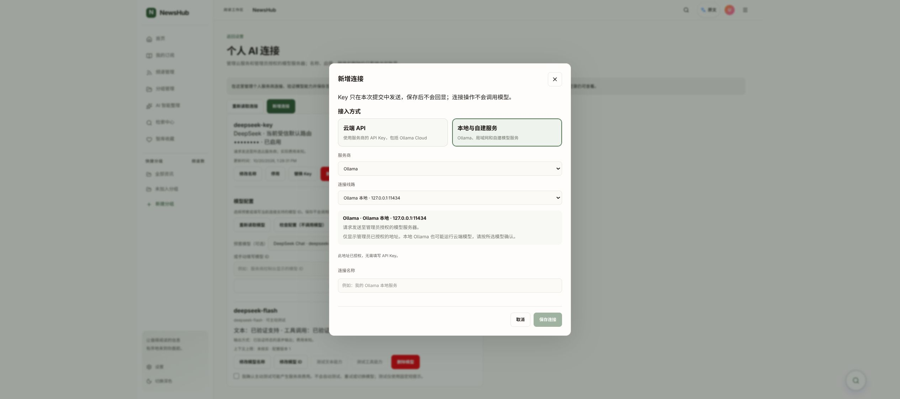
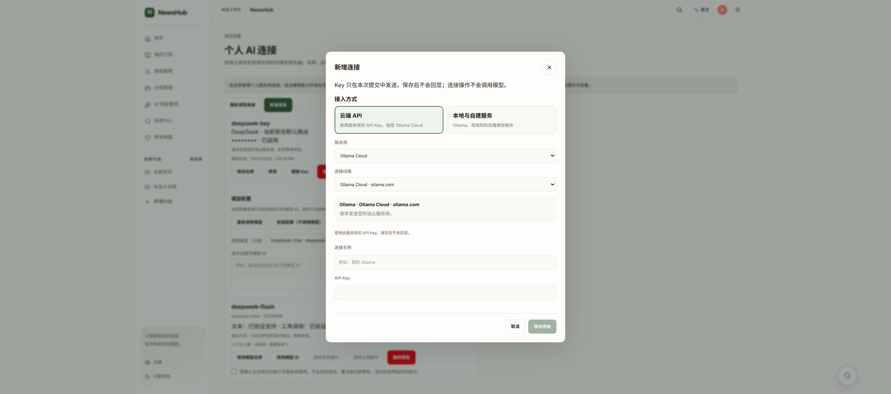

# AI 连接入口整理与 Ollama 恢复：本地交付与验收

日期：2026-10-21。状态：本地已更新，等待人工验收；未提交、未推送、未跑完整 CI。

## 问题与结果

当前源码已有 Ollama 受信端点实现，但本地验收环境未配置 `AI_BYOK_ENDPOINT_MANIFEST`，所以目录没有返回 Ollama；旧网关已退出，绑定代码位于已消失的临时目录，14000 端口未运行。

新增连接改为「云端 API / 本地与自建服务 → 服务商 → 连接线路」。服务商不再因多条线路重复出现；切换接入方式、服务商、线路或认证方式会清空尚未提交的 Key。保留现有连接、用途偏好、请求幂等和账号隔离。

本地运行配置恢复两个仅授权当前验收用户的端点：本地 `http://127.0.0.1:11434/v1`（无需 Key）及 Ollama Cloud `https://ollama.com/v1`（用户自己的 Key）。没有代填 Key、自动创建连接或发起模型推理。本地 Ollama 也可能运行云端模型。

## 代码范围

工作树：`/home/lambert/githubRepos/lambert/news-aggregator-ai-connections-ui`，分支 `feat/ai-connections-ui-20261021`。HEAD/base：`26243ecd347f67cb196afd3996a48501d7911047`，交付为未提交修改。

- `frontend/src/pages/AIModelSettingsPage.tsx`、`aiConnections.css`：分组选择、线路说明和弹窗排版。
- `frontend/src/services/aiConnectionsApi.ts`、`backend/api/services/ai_registry.py`：传递受信端点的网络分类，后端仍负责授权。
- `frontend/tests/pages/AIModelSettingsPage.test.tsx`：同步已有测试的服务商选择方式。
- 本次构建包含 RSS 工作树的已有卡片、搜索和正文提示改动，避免覆盖上一轮成果；这些文件属于此前 RSS 任务。

## 本地运行与回退

持久交付目录：`/home/lambert/.local/share/newshub/ai-connections-20261021`。

- `gateway.compose.json`：恢复网关，固定现有镜像，沿用现有数据库和密钥；仅监听 `127.0.0.1:14000`。Proxy 使用 host 网络，以访问本机 Ollama；出站继续受严格端点合同约束。
- `trusted-endpoints/manifest.json`：应用和 Proxy 共用的用户、IP、版本及认证白名单。云端 DNS 固定到交付时解析的公共 IP；DNS 改变需按合同更新版本并重新加载，不能放宽检查。
- `app.override.json`：应用挂载本次 UI、registry、此前三个微信 RSS 修复文件及端点清单。`compose-command.json` 保存完整的本地 Compose 文件列表。
- 网关使用现有 PostgreSQL 容器在既有网络的地址；若该数据库容器重建，需要重新核对地址。没有重建数据库、迁移数据或轮换 Key。
- `previous-project-grants.json` 保存原项目模型/路由授权以备人工回退，未改变原授权含义；仅补入新的别名和目录路径。
- 如仅回退界面，将 `previous-ui-index.html` 复制为 `frontend/index.next.html`，再原子重命名为 `frontend/index.html`，刷新浏览器即可。旧静态资源保留。代码回退应只撤销上述 AI 文件，不回退已有 RSS 修改。不要删除数据库、密钥或整个本地服务栈。

## 验证结果

- PASS：Node 22 TypeScript 检查；修改的 AI 页面/API 文件 ESLint；Vite 构建；`git diff --check`。
- PASS：现有两个连接管理/API 测试文件，23 项通过，未扩展测试套件。
- PASS：应用就绪 HTTP 200，网关就绪 HTTP 200；通过项目网关读取本机 Ollama 模型目录，HTTP 200，10 个模型。只读模型目录，不属于推理或能力验证。
- PASS：真实 Chrome 中验证两个分类、Ollama Cloud 的 Key 输入、本地无需 Key；已有 DeepSeek 连接仍显示。
- NOT_RUN：真实云端 Key 保存和模型推理、模型能力验证、完整 CI、窄屏/深色人工验收。

## 你来验收

1. 打开 <http://127.0.0.1:9527/settings/ai>，点击「新增连接」。
2. 选「本地与自建服务」，应出现 Ollama 本地线路，不要求 Key。填写连接名称后保存，手动读取模型列表。
3. 选「云端 API → Ollama Cloud」，应出现云端线路和 Key 输入。自行填写 Key 并保存。
4. 需要用于问答/翻译时，再由你主动执行能力测试并保存用途偏好；不要将“目录可读取”当成“模型已验证”。

