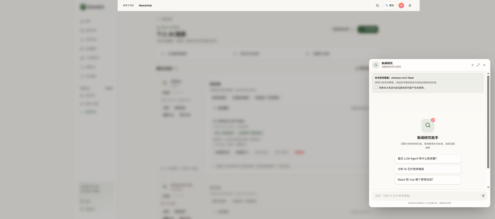

# 研究助手提示去重与默认模型文案简化

2026-10-21，feat/ai-connections-ui-20261021，HEAD 26243ecd347f67cb196afd3996a48501d7911047 上的未提交改动。本地已更新，未提交推送。

## 原因与边界

当前容器日志在 21:25:03 至 21:25:32 有多次 /api/research/ Service Unavailable（503）。截图的状态来自没有拿到 Session-ID 的创建请求；保留原幂等标识，不能推断任务一定没有创建。仅凭日志无法确认 503 的具体服务端错误码，本轮没有通过新推理来重现或声称修好服务端可用性。

重复展示的直接原因：researchTaskMessages 把 task.notice 加成 assistant 消息，ResearchPanel 又渲染恢复状态框。现在仅在有恢复操作时从消息展示中排除系统 :notice 行，保留唯一恢复状态框；不改变底层任务、幂等键、继续接收、取消及重试逻辑。

恢复期间不显示新请求的费用确认；准备新研究时仍显示一次精简确认，直接使用已保存模型。模型名称与 ID 相同只显示一次。

## 文件与验证

frontend/src/components/research/ResearchPanel.tsx；frontend/tests/components/research/ResearchPanel.test.jsx。
PASS：ResearchPanel + useResearch 定向文件共 50 项；TypeScript；定向 ESLint；Vite build；git diff --check。
PASS：浏览器打开研究助手，模型名称不重复、新请求说明已缩短；未发送推理。重复恢复状态通过既有模拟请求中断检查确认只有一条提示。
NOT_RUN：真实模型推理、503 故障复现与根因修复、完整 CI、移动端人工验收。

人工验收：刷新有中断研究的原标签页，打开研究助手，原请求提示仅一条，继续接收按钮仍在，恢复阶段无新请求费用确认；不要将未知请求当成可安全重新创建。新研究页面显示已保存模型及一次费用确认。

回退静态页：/home/lambert/.local/share/newshub/research-notices-20261021/previous-index.html 原子恢复到既有 ai-connections-20261021/frontend/index.html；不清理历史、sessionStorage、数据库或凭据。
