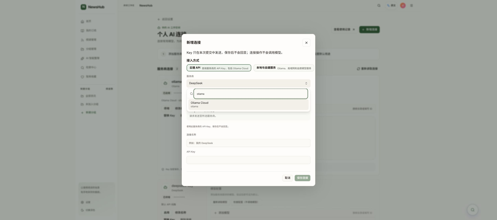

# 连接服务商和线路支持搜索筛选

2026-10-21。本地已更新，未提交或推送。工作树 feat/ai-connections-ui-20261021，HEAD/base 26243ecd347f67cb196afd3996a48501d7911047，交付包含未提交修改。

## 行为和实现

新增连接弹窗中的服务商、连接线路、认证方式复用当前 ModelCombobox（Radix Popover + cmdk），替换原生 select。服务商按名称/标识搜索，线路按名称/profile ID 搜索；只有一条线路时保留禁用展示。过滤不调用接口，不产生推理。

ModelCombobox 增加可配置搜索标签、占位和空结果文案；打开时将弹层挂到所属 dialog 内，避免原生 dialog 顶层遮挡与焦点限制。Esc 先关闭列表并还原触发器焦点，不同时关闭父弹窗。切换服务商或认证方式继续清空未保存 Key，不改变后端接口与授权范围。

根 AGENTS.md 添加 UI 优先级入口，frontend/AGENTS.md 补充 UI implementation：优先已有 shadcn/ui 和共享组件；必要例外记录原因；长列表复用当前搜索选择器；统一设计变量及键盘/弹窗行为。规范不限制语义化布局、标题、标签和文章内容的原生 HTML。

修改：AGENTS.md、frontend/AGENTS.md、frontend/src/pages/AIModelSettingsPage.tsx、frontend/src/components/ui/model-combobox.tsx、frontend/tests/pages/AIModelSettingsPage.test.tsx。规则已同步到原仓库及实现工作树。

## 验证和验收

PASS：4 个 AI 设置/API 定向文件 41 项；TypeScript；Vite build；git diff --check；agent_rules.py；12 项 agent_rules 单元检查。
PASS：全前端 ESLint 无错误；已有 useSuggestedQuestions.ts 的 queryKey Hook 依赖警告 1 条，未改动该模块。
PASS：Chrome 新增连接弹窗输入 ollama，仅显示 Ollama Cloud；Esc 只关闭列表，弹窗保留并恢复触发器焦点。未保存测试连接、未输入真实 Key、未调用模型。
NOT_RUN：全量 CI、完整回归、移动端人工验收和真实推理。

人工验收：进入 /settings/ai → 新增连接 → 服务商，输入 ollama/qwen 检查筛选；清空恢复全部，输入不存在的词检查提示；选中后检查连接线路及认证方式。取消弹窗即可放弃修改。

本地仅追加构建资产并原子替换原静态 index.html。回退使用 /home/lambert/.local/share/newshub/provider-search-20261021/previous-index.html 原子恢复到 /home/lambert/.local/share/newshub/ai-connections-20261021/frontend/index.html；保留数据库、凭据和资产。
