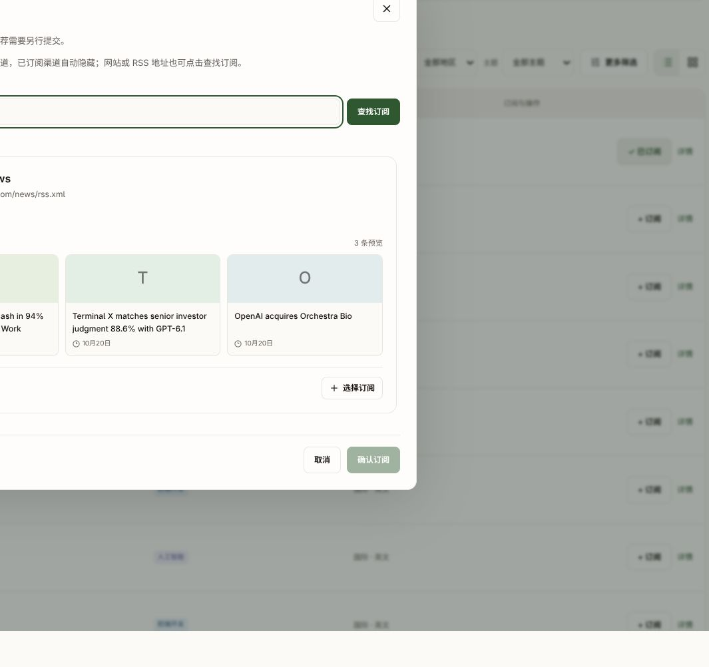

# RSS Discovery MVP 本轮交付与人工验收

本地入口：http://127.0.0.1:9527/channels ，登录后点击“添加订阅”。更新前已打开的页面请刷新一次。

## 本轮功能

- RSSD-01：固定使用用户选定的 Tidings Top200，194 条 HTTPS 来源进入目录；6 条 HTTP 保留在原始清单及接入报告，没有改地址、换源或自动订阅。保留原始 14 个分类；没有补语言或简介。
- RSSD-03：默认浏览目录；关键词搜索、空结果提示、“加载更多渠道”；清空输入自动返回目录；输入关键词后停顿约 250 毫秒自动显示匹配结果，不必点击查找。卡片显示原始 Feed 地址。
- RSSD-07：继续使用已有的选中、分类/分组确认、订阅接口及连接进度；补上订阅终态后的目录缓存刷新，重新打开后已订阅渠道从添加列表隐藏。连接完成和文章首次同步仍分别显示。

代码在独立工作目录 `/home/lambert/githubRepos/lambert/news-aggregator-rss-discovery-mvp`，分支 `feat/rss-discovery-mvp-20261021`，基于 `26243ecd347f67cb196afd3996a48501d7911047`；尚未提交或合并。本轮未改变原工作目录的产品代码或数据库文件。

## 请按这三步验收

1. 打开添加订阅，浏览并点击“加载更多渠道”；直接输入 `OpenAI` 或 `机器之心`，无需点击查找，停顿后应显示原清单中匹配的来源。搜索不存在的名称应显示空结果；清空后应自动恢复列表；连续修改关键词应只显示当前关键词的结果，中文选字结束后再查询。
2. 选中一个来源，确认自己的分类/分组后点击“确认订阅”。在添加记录中查看连接结果；完成后在我的频道确认有该渠道。后台连接失败应显示真实原因。
3. 再打开添加订阅并搜索同一渠道，已建立的订阅应从列表和搜索结果隐藏，在我的频道仍可查看；首次同步完成后再检查文章能否打开。

按步骤反馈 PASS / FAIL / 未测即可。当前三步均等待用户实测；真实 Feed 的可用性和首次文章同步未核验，不把目录存在或请求已保存当作订阅成功。

## 已做的必要检查

- Node 22 前端生产构建、TypeScript 检查、两个改动文件 ESLint 通过。
- 现有 Python 3.12 目录校验接受全部 194 条投影记录。
- 本地 API：分页读取 194 个不同条目；名称搜索与空结果正常；194 条均允许发起现有订阅流程（不代表远端来源健康）。
- `/channels` 和入口构建资源返回 HTTP 200。
- 最终静态审查后移除了误加的输入长度限制，保留原有长 RSS URL 的输入能力；修正后已重新构建。
- 自动化回归、完整 CI、真实订阅/文章同步及浏览器人工验收：NOT_RUN，按用户要求后补。

## 本地更新与回退

只导入目录元数据，并更新现有本地 app 的前端构建文件；保留旧 assets 和原始构建备份，未清理任何用户订阅或文章。同步容器采用只读文件系统，通过只读挂载更新两个种子文件，并仅重建本地 rss-sync 服务以持续使用此清单；app、Miniflux 和数据库服务未重启。

本地备份与覆盖配置在 `/home/lambert/.local/share/newshub/rss-discovery-mvp-20261021/`。这是本地验收补丁，尚未制作正式镜像；重建 app 容器会恢复其镜像内旧前端。再次运行旧 Compose 命令会丢失本轮额外的种子挂载，应保留 `directory.override.json`。

运行该目录中的 `rollback.py` 可恢复原前端入口、种子文件和此前无活动目录的状态，保留已创建的订阅、文章及目录快照。源码回退保留的旧输入为 `backend/api/rss/directory_data/seed-pre-tidings-v1.*`。

完整 200 条接入报告位于独立工作目录的 `backend/api/rss/directory_data/tidings-import-report.json`；原始输入和许可证同目录保留。

## 输入即搜索的本轮优化

延用 TanStack Query 的 useInfiniteQuery：250ms 输入防抖、按 viewer/关键词缓存 30 秒、传递 AbortSignal，输入新关键词时取消旧请求；窗口重新聚焦不触发目录重查。不复制服务端结果到本地状态，不自动触发网站发现或订阅。输入法组合输入期间暂停请求；切换关键词时不展示旧列表，空输入恢复目录。保留手动回车、地址添加和分页。

更新后的类型检查、改动文件 lint、生产构建和本地入口资源检查通过；本轮未运行自动化交互测试，等待用户按上方步骤验收。

参考：[TanStack Query 请求取消](https://tanstack.com/query/latest/docs/framework/react/guides/query-cancellation)、[缓存与默认行为](https://tanstack.com/query/latest/docs/framework/react/guides/important-defaults)。

## 渠道卡片展示优化

“添加频道”内的搜索结果改为完整渠道卡片：频道名称与字母/汉字标识、原 RSS 地址、原始分类标签、已有简介、最多三条已有缓存文章的标题与记录时间、站点域名，以及“选择订阅 / 已选择”按钮。近期文章可打开站内详情；无缓存时明确显示暂无预览，没有外网补抓、示例文章、虚构订阅人数或更新频率。当前接口没有品牌 logo 和封面字段，图块使用文字标识。

沿用现有自动搜索、分页、单项订阅确认和已订阅隐藏。弹窗适当加宽，卡片列表独立滚动，选择后仍在下方确认分类/分组。桌面三栏文章预览，窄屏两栏，长名称和地址可换行/省略。

新增 `frontend/src/features/rss/DirectoryChannelCard.tsx` 和其 CSS；DiscoverDialog 使用新卡片，WorkspaceModal 仅增加可选 className 参数，其他弹窗布局不变。无后端、接口、迁移或订阅协议改动。

检查：TypeScript、三个改动 TSX 的 lint、Node 22 构建及 diff 空白检查通过。本地浏览器检查了 OpenAI 自动搜索及三条缓存预览，机器之心已订阅条目仍被隐藏。未创建订阅；窄屏人工验收、真实文章同步及自动化回归未执行。

请刷新本地页面，打开“添加频道”，搜索 OpenAI 查看卡片；点“选择订阅”检查选中和确认区域。实际订阅仍由用户验收。

本轮前端入口回退文件：`/home/lambert/.local/share/newshub/rss-discovery-mvp-20261021/backup/before-rich-cards/index.html`。旧 assets 保留；恢复该入口即可撤回卡片外观，不影响数据。

## 新智元添加记录“结果待核对”恢复

用户反馈固定 Top200 中的新智元 Feed（wechat2rss.xlab.app，文件名 ede30346413ea70dbef5d485ea5cbb95cca446e7.xml）停留在结果待核对。

现场证据：原 register 操作已执行五次并处于 manual_blocked / possibly_sent，错误 create_outcome_unproven；Miniflux 只读核对已发现同一原始 URL 的唯一 Feed 19，而本地尚未关联。说明来源在原请求超时后已创建，不能据此重新 create。

通过现有 addition_action 的 reconcile 路径恢复原任务，保留 owner、意图版本和幂等控制，由现有 worker 关联已有 Feed；没有直接重置成 pending、没有重发 create、没有重启 Miniflux。恢复后原操作 succeeded，绑定 ready，策略版本和已应用版本均为2，用户订阅关系存在；随后同步20条文章。添加记录页已实际显示“已连接 · 已有20篇文章可阅读”。

这是对该条现有任务的现场恢复，未修改产品代码，也不声称其他超时来源已恢复或超时机制已全面改造。未运行自动化回归。

> 截图包含个人订阅feed标识，留在本地验收目录，未纳入提交。

## 机器之心正文被微信控件文字覆盖的修复

目标文章：本地 `/news/126`，“AI Agent学会自我进化！微软与UCSB新研究：自己读论文、改代码”。原文章内容及 Miniflux Entry 114 都只有微信视频、小程序、赞、在看等控件文字，数据库 full_content_revision=1，完整性 unknown。前端实际按已保存内容渲染，且工具栏错误显示“正文已就绪”。

诊断通过现有安全 HTTP 传输只读检查该 Feed，未将此诊断响应直接写入正文：同一条 RSS item 的 content:encoded 约25336字符，已包含正文和图片；Miniflux 当前内容仅102字符，绑定却启用了 full_content/crawler。Miniflux 2.3.3 的[处理逻辑](https://github.com/miniflux/v2/blob/2.3.3/internal/reader/processor/processor.go)会用无错误的非空提取结果替换 Feed 内容，此处微信原文页面控件被当作成功提取结果。

最小修复：

- 只将已核对的机器之心精确 Feed URL 加入现有 NATIVE_FEEDS，保留 RSS 自带正文，不新增采集器或扩大为所有微信域名白名单。
- 通过既有 change_policy/worker 将当前绑定切换至 feed 模式（策略版本3），等待应用后只提交一次持久 refresh_feed，由 Miniflux 重新读取同一来源，再由现有 sync/CAS 更新本地正文。没有直接写入抓取结果，没有删除文章或用户关系。
- content_store 的既有提交校验增加严格控件-only识别：同时含两条“轻点两下取消”提示、移除已知控件名称后不剩正文文字才拒绝。真实短文及带页尾控件的真实文章仍可保存。
- FullContentSection 使用现有完整性标签，unknown 不再显示“正文已就绪”，也不承诺翻译能补全缺失原文。

结果：文章126正文已恢复为6489个Markdown字符，revision=2，图片与正文段落可见，来源 ready，模式 feed，策略及已应用版本均为3。完整性仍为 unknown，没有人工逐字核对原文，因此保持“已获取内容，完整性未确认”。浏览器实际查看了恢复后的图片与研究正文。

验证：Python语法和三个不访问数据库的定向内容校验通过（控件-only拒绝、正常短文保留、正文附控件保留）；前端类型、改动文件lint、Node22生产构建和diff检查通过。未新增完整测试体系，完整回归和用户人工验收仍待后补。

本地同步服务通过 `wechat-body.override.json` 只读挂载两个后端修正文件；仅在无运行中控制操作时重建 rss-sync，app/Miniflux/数据库未重启。前端通过现有本地补丁更新；正式镜像、提交及合并尚未执行。

回退：本轮源文件与旧前端入口分别保留在本地交付目录 backup/before-wechat-body-fix 和 backup/before-body-status-ui。可移除本轮额外代码挂载并恢复旧入口，保留已恢复的文章及用户数据；不建议把该来源改回会覆盖 RSS 正文的 full_content 模式。恢复模式须仍走 change_policy 和当前版本，不能直接改远端 crawler。

请刷新 http://127.0.0.1:9527/news/126 ，确认正文段落、图片和状态提示；本轮仅确认该精确来源，其他微信来源未批量核验。

> 截图包含个人文章内容，留在本地验收目录，未纳入提交。

## 渠道介绍补充

按用户要求为原194条目录渠道补充简短介绍。数据来自同一 Tidings 固定提交的[data/feeds.json](https://github.com/fuxiaoai/tidings-rss/blob/f9b54abf9dd3e7af2a1dda12bca06c8fe8b57d7b/data/feeds.json)，194个Feed地址全部精确匹配，不添加其他来源。上游有具体介绍时沿用；只有分类/媒体类型时整理成简短说明，未当作站点自行提供的简介。AWS和OpenAI的补充介绍参考其[官方博客](https://aws.amazon.com/blogs/machine-learning/)及[官方动态](https://openai.com/news/)。出处与原始简介保留在运行数据目录tidings-descriptions.json，锁中记录元数据输入hash和本地metadata_revision。

卡片名称下方直接显示介绍；没有缓存文章时去掉“暂无文章预览”空块，有文章时仍显示真实文章预览。没有新增请求接口或访问网站来生成卡片，没有新增语言字段、订阅统计或来源。

本地已导入含194条非空简介的新快照，稳定ID、Feed地址、名称、分类和原始OPML未变。前端类型/lint/构建、元数据完整性和只改简介校验通过；API及实际浏览器已确认CISA展示具体安全介绍。完整自动化回归未运行，用户请刷新添加频道窗口，搜索CISA或aws.amazon.com验收。

回退：本地交付目录backup/before-descriptions保留上一版seed-v1.json、锁及前端入口；恢复种子并通过既有import_pinned_seed激活即可，保留用户订阅与文章。同步服务的只读种子挂载已原位更新，无服务重启。

> 截图包含个人订阅信息，留在本地验收目录，未纳入提交。

## 微信正文统一规则与新智元恢复

追加需求与人工验收见[RSSD-07.1](tasks/content/RSSD-07.1-微信RSS正文统一处理.md)。本轮把按公众号精确URL修补升级为微信转RSS类型规则：识别wechat2rss.*及wechat2rss.com，统一默认feed且禁止full_content；RSSHub已有feed-only规则保留。并在原文URL校验及EngineAdapter.refetch_entry物理边界拦截mp.weixin.qq.com，保留owner/epoch/CAS，不引入新采集器。纯上游异常响应和已有控件-only拦截继续执行。

新智元源19的原20条都被二次抓取覆盖。切换至feed模式后首次刷新因HTTP缓存未重新读取内容；临时使用Miniflux[ignore_http_cache字段](https://miniflux.app/docs/api.html)后通过持久refresh_feed恢复。成功后已恢复原False缓存设置，不增加常规轮询流量。原任务身份和文章ID保留，无删除重建。

结果：新智元20条均有RSS正文，文章158正文10416字符、revision2，已实际浏览正文/图片；机器之心10条无控件-only正文。两个微信绑定均feed/ready、策略版本3已应用。未逐篇核实全文完整性。其他任意第三方桥接格式不在本次保证范围，上游不可用也不能凭空补全文。

本地部署：无运行中的控制操作时更新readonly代码挂载并重建rss-sync；app为无入口脚本的直接waitress命令，复制三个后端修正文件后仅重启app加载统一策略，没有运行migration。既有前端构建保留，app/rss-sync均healthy，Miniflux和数据库未重启。

定向离线校验通过，完整自动回归未运行。代码在既有独立工作目录，基于26243ecd347f67cb196afd3996a48501d7911047，尚未提交、合并或制作正式镜像。当前微信渠道核查和页面验证属于本地证据，用户验收仍待反馈。

> 截图包含个人文章内容，留在本地验收目录，未纳入提交。
