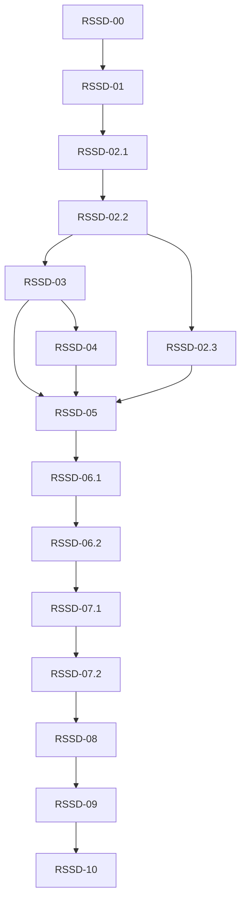

# RSS Discovery V1任务总览与实施计划

> 后续获授权实施时使用superpowers:executing-plans或用户选择的执行方式，逐项按复选框记录。本轮仅编写任务文档，不选择执行方式，不启动实施、提交、真实服务或部署。

**Goal：** 在现有RSS架构中交付“精选 → 搜索 → 详情 → 分类/分组确认 → 可靠订阅 → 阅读”的完整闭环。

**Architecture：** 扩展既有版本化目录与独立公共资料贡献，搜索只读本地数据；显式网站发现和RSS写入继续复用Miniflux/持久操作，公共频道订阅保留原授权与响应。

**Tech Stack：** 当前Django/SQLite WAL、React/TypeScript/TanStack Query、Miniflux；Python 3.12、Node 22及现有锁文件，不增加搜索/采集服务。

**Spec：** [完整方案v1.3](完整方案.md)；跨任务唯一接口定义见[开发合同](开发合同.md)。

**基线与范围：** HEAD `26243ecd347f67cb196afd3996a48501d7911047`、本地origin/main `b5647fade4f33928ff55000df3b176bbb9208626`，2026-10-21源码核对；不是最新远端/生产证明。保留已有脏DB及无关文档。所有新增代码/测试/命令均为计划目标，未运行。

## 任务总览

15张任务卡按功能交付组织。原RSSD-02/06/07保留为父编号，分别由其所有子项完成后才可标父任务完成；不是新增三项重复工作。任何一项可以单独审阅，但独立验收允许有明确前置依赖。基础模块的服务/HTTP交付不宣称整个产品已可用，用户全流程由08/09收口。

| 任务卡 | 直接依赖 | 独立交付物 | 当前状态（审阅 / 实施 / 证据） |
|---|---|---|---|
| [RSSD-00：冻结实际差额与开发合同](tasks/planning/RSSD-00-冻结实际差额与开发合同.md) | 无 | 源码差额表、50条固定搜索标注、同条件性能基线及冻结后的接口/任务依赖。 | 待审阅 / 未开始 / NOT_RUN |
| [RSSD-01：接入已选定的TidingsTop200清单](tasks/catalog/RSSD-01-接入已选定的TidingsTop200清单.md) | RSSD-00 | 已选Top200的200条逐项处理结果、NewsHub目录产物、来源锁与必要校验报告；不再补源或设语言配额。 | 待审阅 / 未开始 / NOT_RUN |
| [RSSD-02.1：稳定频道身份与原子快照发布](tasks/catalog/RSSD-02.1-稳定频道身份与原子快照发布.md) | RSSD-01 | v1/v2兼容导入、历史身份约束、单一激活服务和inspect/preview/publish/rollback/unpin管理命令。 | 待审阅 / 未开始 / NOT_RUN |
| [RSSD-02.2：公开频道入目录与即时撤回](tasks/catalog/RSSD-02.2-公开频道入目录与即时撤回.md) | RSSD-02.1 | 公共资料投影构建函数、按来源贡献过滤的安全查询入口及同URL独立资料回退。 | 待审阅 / 未开始 / NOT_RUN |
| [RSSD-02.3：后台目录维护与回退版本保护](tasks/catalog/RSSD-02.3-后台目录维护与回退版本保护.md) | RSSD-02.2 | 同进程单一在途维护、输入变化检查、退避、heartbeat保护和固定回退行为。 | 待审阅 / 未开始 / NOT_RUN |
| [RSSD-03：中英文频道搜索与稳定分页](tasks/discovery/RSSD-03-中英文频道搜索与稳定分页.md) | RSSD-02.2 | 数据库检索、有限同义词、过滤交集、签名游标与固定50条相关度评估。 | 待审阅 / 未开始 / NOT_RUN |
| [RSSD-04：编辑精选与可信健康状态](tasks/discovery/RSSD-04-编辑精选与可信健康状态.md) | RSSD-03 | 精选配置、独立证据记录/读取、分类配额、首屏12条及过期降级。 | 待审阅 / 未开始 / NOT_RUN |
| [RSSD-05：可授权的频道资料与兼容发现接口](tasks/discovery/RSSD-05-可授权的频道资料与兼容发现接口.md) | RSSD-03、RSSD-04、RSSD-02.3 | 列表增量参数、只读详情、批量授权预览、动作判别联合、兼容能力扩展及前端服务。 | 待审阅 / 未开始 / NOT_RUN |
| [RSSD-06.1：共享发现浏览与关键词搜索界面](tasks/discovery/RSSD-06.1-共享发现浏览与关键词搜索界面.md) | RSSD-05 | /channels/discover、共享DiscoverPanel、完整分页与URL/弹窗各自状态边界。 | 待审阅 / 未开始 / NOT_RUN |
| [RSSD-06.2：频道详情与明确的订阅确认](tasks/discovery/RSSD-06.2-频道详情与明确的订阅确认.md) | RSSD-06.1 | 资料详情、三条以内授权标题、两种订阅动作确认、匿名登录返回与安全选中恢复。 | 待审阅 / 未开始 / NOT_RUN |
| [RSSD-07.1：RSS订阅与跨版本请求恢复](tasks/subscriptions/RSSD-07.1-RSS订阅与跨版本请求恢复.md) | RSSD-06.2 | 目录版本校验、三类旧选择兼容、不可变意图重放、任务恢复/取消与前端真实接线。 | 待审阅 / 未开始 / NOT_RUN |
| [RSSD-07.2：公共频道订阅的分类与分组原子保存](tasks/subscriptions/RSSD-07.2-公共频道订阅的分类与分组原子保存.md) | RSSD-07.1 | 单source可选字段支持、事务内公共资格/归属复查、重复不覆盖及public前端接线。 | 待审阅 / 未开始 / NOT_RUN |
| [RSSD-08：真实候选与隔离Miniflux闭环核验](tasks/acceptance/RSSD-08-真实候选与隔离Miniflux闭环核验.md) | RSSD-07.2 | 24个不同精选的近期证据、网站发现/订阅/首次同步及unknown恢复的真引擎记录。 | 待审阅 / 未开始 / NOT_RUN |
| [RSSD-09：安全性能与浏览器整体验收](tasks/acceptance/RSSD-09-安全性能与浏览器整体验收.md) | RSSD-08 | A01～A23回归结果、首批/10k性能对比、三角色桌面/412px浏览器证据和未测清单。 | 待审阅 / 未开始 / NOT_RUN |
| [RSSD-10：候选交付与版本回退演练](tasks/acceptance/RSSD-10-候选交付与版本回退演练.md) | RSSD-09 | 精确SHA验收矩阵、适用完整CI、开关/固定快照回退记录、运维步骤和遗留边界。 | 待审阅 / 未开始 / NOT_RUN |

## 依赖关系与建议顺序

推荐顺序：00 → 01 → 02.1 → 02.2；随后02.3维护与03查询在文件/资源独立时可并行，04在03之后接管featured分派。05汇合03/04/02.3 → 06.1浏览 → 06.2详情确认 → 07.1 RSS → 07.2公共订阅 → 08真引擎 → 09整体验收 → 10交付。

08的lab守卫、受控Publisher与24源候选清单可在04完成后提前准备；本卡最终完成仍依赖两类订阅闭环。09可以提前写安全/性能/浏览器场景，但最终证据必须对07/08后的实际候选。15项全部串行也可以，不以并发作为交付要求。

## 全局约束

- 每批最多两个独立写入目标。Schema、迁移、路由、公共DTO和来源锁文件单写者。
- Miniflux负责常规Feed获取与正文策略，不新增RSS解析器、网页提取器、全网爬虫、独立搜索服务。
- 目录发布不创建Source、FeedBinding、ChannelSubscription或register操作；不调用初始化/清空/生产迁移流程。
- 首版新增外部目录固定使用用户提供的Tidings Top200 OPML，不补充其他清单、不设中英文数量配额；200条逐项有结果。精选从这200条中展示，核验结果不等于生产可用性。
- 沿用8 MiB、10,000条、100个collection上限；查询≤200字符、≤10词项，每项≤5个同义扩展；默认20条、上限50条。
- UI普通关键词300ms防抖；IME组合期间不发请求；远程网站发现必须显式提交。
- 分页绑定目录版本与全部查询条件；公开撤回在搜索匹配/排序/分页前排除资料贡献，不等待投影更新。
- 使用现有private/no-store、viewer分区、CSRF、幂等和租约/版本围栏；共享物理Feed不能扩大私人访问范围。
- 公开元数据、健康证据、文章预览与个人订阅是不同来源；上游validated_at不是本系统verified_at。
- 精选的编辑顺序与健康独立；7天过期只使健康stale，不自动清空推荐。目录主题、个人category_id和group_ids分别保存。
- runtime启动/每日维护不可重激活旧种子；构建失败不终止sync，旧构建不得覆盖新目录，固定回滚版本不得被后台改回。
- 2 vCPU/4 GiB、10k记录、10并发、预热后1000请求：p95≤300ms、p99≤800ms；业务SQL≤12，20→50条增长≤2；20条响应≤80KiB。
- 测试先失败后实现。PASS/FAIL/NOT_RUN/BLOCKED分别记录；Mock、真实隔离引擎与生产证明不能互换。

能力开关通过现有capabilities的顶层extensions.rss_discovery协商，不直接向严格校验的features集合加key；新旧客户端、能力缺失及关闭回退归05。后续计划统一存本目录上级的功能目录，不复制到docs/superpowers。

## 审查重点

1. 旧seed覆盖活动v2、迟到构建/ABA、固定回退被自动改回：02.1/02.3测试checksum+revision和跨启动/每日检查。
2. public撤回但旧简介仍参与搜索/筛选/facets、同URL外部记录继承私人资料：02.2/03/05测试重建关闭后的下一请求。
3. 响应丢失后目录换版，重放先404或重复register；同键不同分类/组：07.1测试原operation恢复及409。
4. public订阅把分类/组静默丢弃或轮询不存在的operation：07.2测试新关系原子保存、越权整笔回滚、旧设置保留。
5. IME/域名样式关键词、能力扩展严格解析、账号切换/过期选择：05/06.1/06.2测试不外连、fail closed和旧结果拒收。

## 模块与文件所有权

| 写入边界 | 顺序与单写者 |
|---|---|
| directory_models.py、模型注册、所有迁移 | 02.1单写者；后续实际模型差额交回同一所有者，不并行生成迁移 |
| directory_build.py、来源锁/种子 | 01编译 → 02.2公共适配串行交接；04编辑配置单独文件，输入锁更新由目录所有者整合 |
| directory.py / directory_publish.py | 02.1激活/身份 → 03查询委托串行；02.3仅维护入口，不旁路激活 |
| directory_public.py | 02.2；03/04/05只消费可见贡献查询，不各写一套权限 |
| runtime.py / directory_maintenance.py | 02.3；不与03共享写文件，运行资源仍隔离 |
| directory_search.py / featured / evidence | 03查询 → 04featured分派串行，05仅消费 |
| API路由、能力、前后端公共DTO/解析/请求服务 | 05单写者，特别包含api.ts严格能力解析器和workspaceApi.ts机器码 |
| 共享面板、路由、旧添加回退 | 06.1浏览 → 06.2详情确认串行 |
| SubscriptionAction / queryRefresh | 06.2 → 07.1 → 07.2串行，复用现有刷新入口 |
| RSS与公共订阅服务 | 07.1 subscriptions系列 → 07.2 channel_views；不建立平行业务服务 |
| ops/rss/discovery_v1及运行证据 | 08真引擎 → 09性能/浏览器；只使用任务专用DB/端口/容器 |

## A01～A23覆盖与验收责任

| 验收 | 负责功能任务 | 最终证据 |
|---|---|---|
| A01默认精选 | 04、06.1 | 09两入口浏览器 |
| A02固定Top200接入 | 01 | 200项接入/受限/拒绝/重复结果、输入hash及无额外补源 |
| A03精选质量 | 04 | 08近7天24源真实核验 |
| A04名称 / A05主题别名 | 00固定标注、03 | 09固定查询结果 |
| A06筛选 / A07分页 | 03、06.1 | 09浏览器与容量 |
| A08去重 | 01、02.1 | 09身份负例 |
| A09原有频道 | 02.2、02.3 | 08本地投影/同步 |
| A10未知与空态 | 04、05、06.1、06.2 | 09真实界面 |
| A11重复 / A12双用户 | 07.1、07.2 | 08真实资源计数 |
| A13公私边界 | 02.2、04、05、07.2 | 08/09角色负例 |
| A14换号 | 05、06.1、06.2、07 | 09浏览器 |
| A15取消/未知 | 07.1 | 08对账恢复 |
| A16公开撤回 | 02.2、03、05、07.2 | 09重建关闭下读取 |
| A17版本漂移 | 02.1、02.3、03、06.2、07.1 | 08/09迟到与重放 |
| A18身份/CSRF/组归属 | 05、06.2、07.1、07.2 | 09负例与公共原子性 |
| A19网络攻击 | 现有边界回归、08、09 | 09实际拨号层 |
| A20元数据攻击 | 01、09 | 09受限解析负例 |
| A21 GET零副作用 | 03、05、09 | 09 500次计数 |
| A22发布失败与回退 | 02.1、02.3 | 10跨维护回退演练 |
| A23核验隔离 | 08 | 08守卫/资源身份，10交付核查 |

性能、三角色、桌面/412px、键盘/焦点/IME和真引擎是额外完整性门禁，不因A编号表中某行离线通过而省略。精确数值在开发合同C07，只维护一份。

## 审阅与执行记录方式

你可以逐项回复“RSSD-xx：通过 / 需修改（原因）”，也可只审阅一个模块。审阅通过不等于代码完成；执行时将“未开始”改为进行中，再按真实证据登记，不预勾选未来步骤。

任务卡均包含目标、交付物、范围/非范围、直接依赖、实现/文件/接口、开发步骤、自动断言/命令、人工步骤、完成标准及回退。通用合同只引用C编号，不复制邻居实现。开发者优先读本卡及共同合同；实际新发现改变共同接口时，先更新共同合同和受影响卡。

每项代码任务先负例再实现；运营/最终交付检查不人为制造失败。依C07/C08选择局部检查，完整CI只在适用集成节点收口。未来若执行方式尚未指定，计划审阅后再选择内联或受监督代理执行；本轮不要求选择，也不启动任何执行流程。

## 本轮文档交付边界

完成的是文档目录、15张任务定义、依赖/所有者/验收覆盖及共同合同；产品源码、迁移、fixture、测试脚本、CI、真实Feed、浏览器和部署均未改动或运行。文档检查记录在最终交付回复，不用虚构产品证据目录。
