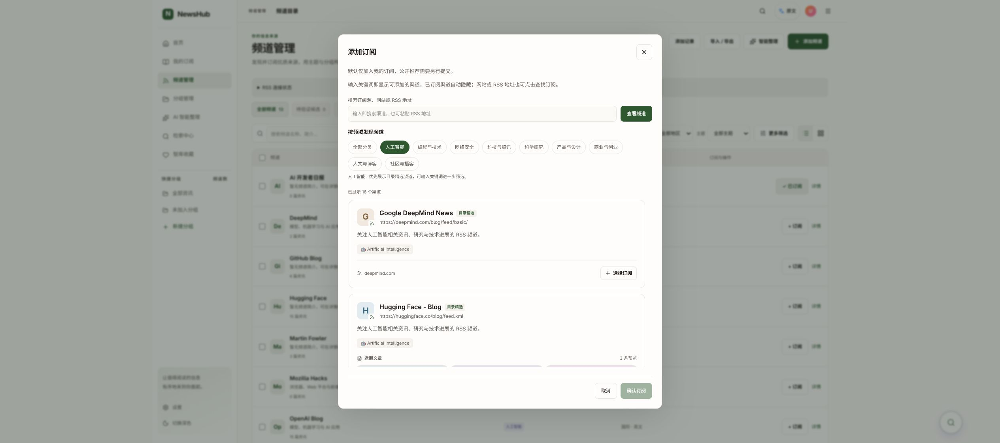

# 分类发现频道：本地交付与验收

日期：2026-10-21。已更新本地页面，未提交、未推送；等待用户人工验收。

## 功能

添加频道默认「全部分类」，可选择人工智能、编程与技术、网络安全、科技与资讯、科学研究、产品与设计、商业与创业、人文与博客、社区与播客九个领域。分类依据现有 Tidings Top200 目录标签归并，没有新增频道或调用模型。

每类优先展示固定规则挑选的代表频道，标记「目录精选」；不表示已验证可用、实时热门或个性化推荐。名称精确/前缀匹配优先于精选顺序。已订阅频道继续隐藏，需主动选择并确认才添加。

服务端先按分类和关键词过滤再分页，游标绑定目录快照、关键词、分类和排序版本；不能将人工智能下一页游标用于网络安全。前端沿用 TanStack Query，缓存按当前用户、关键词、分类区分；切换分类清空已选频道，取消旧请求，加载时不显示旧类别卡片。弹窗列表高度缩短，保留分类和确认操作的可见区域。

## 实现位置

- backend/api/rss/directory.py：分类标签映射、精选规则、搜索排序、分类分页。
- backend/api/rss/directory_http.py：接收可选 category 参数；保留现有权限和文章预览边界。
- frontend/src/features/rss/DiscoverDialog.tsx：默认全部、分类标签、组合搜索和缓存。
- DirectoryChannelCard.tsx / directoryChannelCard.css：精选标记及布局。
- frontend/tests/features/rss/DiscoverDialog.test.tsx：补一条组合搜索检查；同步此前卡片和空状态的旧测试断言。

接口 GET /api/rss/directory/?q=OpenAI&category=ai。category 为空代表全部；响应额外包含 categories 数组，各频道额外包含 recommended 布尔值。无效分类或跨分类旧游标返回校验错误，不静默切换。

## 验证

PASS：TypeScript、修改的前端源文件 ESLint、Vite 构建、Python 语法、git diff --check；发现弹窗定向测试 25 项。

PASS：实际本地服务只读检查分类与关键词、同类无重复分页、跨分类游标拒绝；Chrome 检查默认全部、人工智能结果、组合搜索、无匹配状态、已订阅隐藏和最终弹窗截图。

NOT_RUN：完整后端回归、完整 CI、实际新增订阅、移动端人工验收。没有迁移数据库或调用模型。

## 你来验收

1. 刷新 http://127.0.0.1:9527/channels，点击添加频道，默认应选全部分类。
2. 点击人工智能，再搜索 OpenAI，只应显示该领域匹配结果；切换网络安全时不应残留 AI 结果。
3. 清空关键词，查看当前领域精选和其余频道；已订阅的机器之心、新智元等不重复出现。
4. 选择一个需要的频道，再确认订阅；切换分类后旧选择应清空。

## 版本与回退

工作树 news-aggregator-rss-discovery-mvp 和 news-aggregator-ai-connections-ui，HEAD/base 均为 26243ecd347f67cb196afd3996a48501d7911047，包含本次未提交修改；此前 AI、正文和 RSS 改动保留。

持久运行目录 /home/lambert/.local/share/newshub/rss-category-filter-20261021 保存后端两个文件、category.override.json、完整 compose-command.json 和 previous-index.html。只重新创建应用容器，未重建 RSS/Miniflux/数据库。

回退仅恢复 previous-index.html 为当前 frontend/index.html，并使用 article-opening-20261021/compose-command.json 的原文件列表重新创建 app，从而撤销分类后端挂载，保留此前文章、AI 和 RSS 修复。不清理数据库、静态资源或其他工作树。
