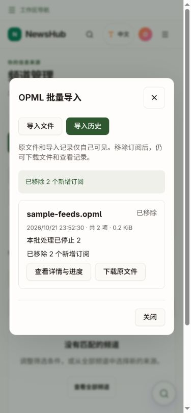

# RSS OPML 批量导入、历史文件和按批次移除订阅

本次交付在现有频道管理和 OPML 预览/确认流程上完善界面，保存原始文件，并允许本人按导入批次移除新增订阅。用户已确认删除范围仅限本批新增个人订阅，保留共享频道和文章。

基线：`main@b5647fade4f33928ff55000df3b176bbb9208626`；工作分支 `feat/rss-opml-import-20261021`。main 随后前进到 `1e66e22f`，其中并行新增的 NativeSelect 已按其原文件复用，避免 add/add 冲突；本分支不合并或改写 main 历史。本阶段仅修改任务文件，不改原工作区的数据库或既有预览服务。

## 功能与边界

- 频道管理 →「OPML 批量导入」→ 上传、预览、全选有效频道、映射分组、确认、查看逐项结果。限制沿用最多 500 个订阅、1 MiB；解析不发网络请求，确认后复用现有导入/Miniflux 控制任务。
- 「导入历史」每页 20 条，展示文件名、时间、结果统计；可打开详情和恢复进度。预览时即保存原文件，确认有效期仍为 30 分钟。历史预览超过会话后需下载原文件并重新预览，不恢复已失效凭据。
- 原文件以私有 BinaryField 随批次保存，下载端点要求登录且限定本人，以 attachment / application/octet-stream / private,no-store / nosniff 返回；不放入公共 media。列表和详情不返回原文件、预览 token 或含凭据的无效解析地址。列表查询不读取文件大字段。
- 删除前有单独确认。「移除此批新增订阅」停止未完成项目、取消关联控制操作并更新 lease fencing，然后仅移除有实际创建证据且当前仍由本人持有的原订阅 ID。共享 Source、文章、其他人的订阅和历史文件保留。重复移除返回原结果，不扩展删除范围。
- 创建证据来自真正创建 ChannelSubscription 的事务，异步和 binding 已就绪的同步路径均记录。重复导入不会获得原订阅的创建归属；取消后再订阅的关系有不同 ID，不被旧批次删除。
- 历史中的「本批处理已停止」表示项目不再由本批处理；「已移除 N 个新增订阅」仅统计实际移除的订阅，不把保留的已有订阅计入删除数量。
- 旧批次原文件无法补回，创建归属默认未知，不执行推测删除。导入创建的分组保留，即使批次移除后成为空组。
- 导入进度变化和移除成功均复用 refreshRssViews，刷新当前用户的频道、分组、资讯来源与列表缓存，避免切回首页看到旧列表。

## 源码范围

后端：`backend/api/rss/{import_models,opml,opml_views,subscriptions}.py`、`backend/api/urls.py` 和 `0082_opml_history` 迁移。前端：频道管理入口、OpmlDialog、OpmlHistory、共享 NativeSelect 和 OPML 类型/查询刷新。专项测试覆盖历史文件、批次归属、会话隔离、重试和缓存。

## 本地验证

运行时：Python 3.12（复用已有兼容环境，未修改其依赖）和 Node 22.23.3；前端按 package-lock 在本工作区独立 npm ci。后端以 env -i 启动，使用合成 secret、独立 /tmp SQLite、禁用采集调度，无真实 .env、用户数据或收费服务。

| 检查 | 结果 |
|---|---|
| 既有 OPML 基线 | PASS：后端 11 项；前端 OPML/恢复/频道页 25 项 |
| 新行为缺失时的回归证明 | 新历史/删除后端测试 6 FAIL（404/405 等预期缺失）；新前端历史 4 FAIL、批量选择 1 FAIL；缓存回归在修复前 FAIL |
| 后端最终专项 | PASS：120 项，28.89s |
| 前端最终完整 Vitest | PASS：106 文件、751 项，13.09s |
| TypeScript / ESLint | PASS；Lint 0 error，useSuggestedQuestions.ts:32 有既有依赖警告 |
| Vite 生产构建 | PASS；停止处理文案调整、复用 main 共享 NativeSelect 后，均再次通过 OPML 专项 24 项与构建；组件复用后类型检查和 Lint 也通过 |
| diff 空白检查 / 只读代码审查 | PASS；审查发现的资讯缓存缺失已修复并回归 |
| 真实浏览器、合成数据库 | PASS：登录、导入历史、确认移除 2 个新增订阅、移除后原文件仍可下载；下载文件逐字节与原文件一致 |
| 390px 窄屏 | PASS：历史、按钮和移除结果无横向溢出，截图见下 |
| 浏览器工具上传 | BLOCKED：ChatGPT 扩展未允许 file URL 访问，未更改权限；multipart 字节上传/预览/选择/确认由自动化测试覆盖 |
| 实际 Miniflux/线上部署/用户验收 | NOT_RUN；浏览器验收使用合成 engine 完成边界，不代表真实 Feed 可达性 |
| GitHub CI | 本地验证时尚未运行；提交后以实际 PR head 检查为准，Draft 快检不等于全量合并门禁 |

最终后端命令（在上述隔离环境中）：

```sh
python -m pytest -q \
  backend/api/tests/rss/test_opml_import.py \
  backend/api/tests/rss/test_opml_history.py \
  backend/api/tests/rss/test_subscriptions.py \
  backend/api/tests/rss/test_control_worker.py \
  backend/api/tests/rss/test_rsshub_subscription.py \
  backend/api/tests/rss/test_rsshub_generic.py
```

前端最终命令（frontend/，Node 22）：`npm run typecheck`、`npm run lint`、`npm run test:run`、`npm run build`。新增真实控制 worker 并发回归让 create_feed 暂停期间移除批次，再放行远端响应，验证不创建订阅且远端 feed 收敛为禁用；不以简单 mock 取消代替该证据。



## 手工验收

1. 频道管理 → OPML 批量导入：选择文件，检查预览、有效项全选/取消、分组和确认结果。
2. 关闭后重新进入导入历史：查看文件名和结果，下载原文件，打开详情查看进度。
3. 使用同时包含已有频道和新频道的文件：确认「移除此批新增订阅」，检查只有本批新增订阅被移除，已有订阅、共享文章和历史文件保留。

反馈版本与各项 PASS / FAIL / 未测即可。浏览器本地预览仅用合成账号与数据，不替代真实 Miniflux 和用户验收。

## 发布与回退

部署前需在授权的目标环境执行前向迁移 0082；本轮只在隔离数据库执行迁移，不迁移现有实例。回退应用代码时保留新增数据列和批次记录；不要通过反向迁移删除已保存的用户文件。旧应用不会显示新的历史/移除功能，已移除订阅需用户从保留文件重新导入。发布、合并和生产数据操作仍需独立授权。
