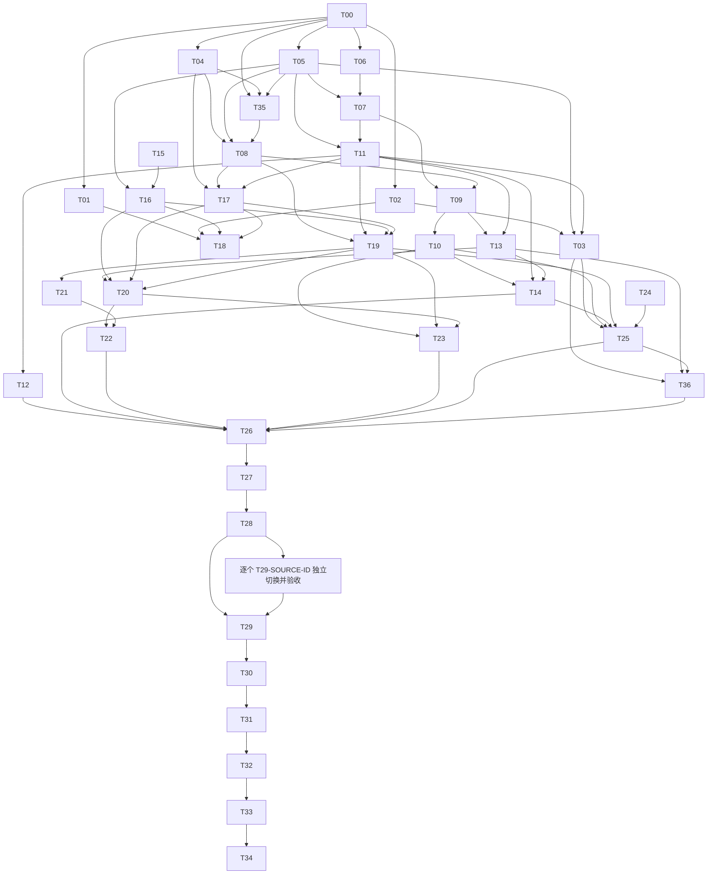

# 任务依赖、条件门禁与安全并行

以下DAG定义当前37个主任务。所有节点还隐含G0（规划审核/合同冻结）。有向边表示上游验收合并后的依赖，不允许拿上游未合并分支当通过。

图中T29到T30的直接边是汇总门禁；T29须等待所有实际单源工单（依赖T28且锁source-cutover）后才DONE。此处展开S_ALL便于阅读，不新增第38个主任务。T24生成N个真实工单后，将其逐个节点替换集合占位并重新校验无环。

## 不靠依赖图判断可并行

候选必须同时满足：前置全DONE、合同冻结、没有共享model/migration/API合同/文件、运行资源不冲突、总并发≤3。T05独占schema；所有共用urls.py、serializers.py、views.py、公共TS类型、依赖清单修改由主控排定串行集成窗口，不能仅因业务模块不同就同时写。

| 建议组 | 前置 | 可并行节点 | 互斥检查 |
| --- | --- | --- | --- |
| P0 证据 | G0 | T00 / T15 / T24 | 隔离引擎、目录快照、来源盘点各自独立；实际副本缺失只阻塞T24运行部分 |
| P1 首组实现 | T00 | T02 / T04 / T06 | ops与SDK与纯转换不同文件；依赖清单统一串行落地；不同时改schema |
| P2 模型后 | T05/T04/T06及相应上游 | T07 / T08 / T16 | content_store、operations、directory各自文件；公共路由/API只依冻结fixture，统一串行集成 |
| P3 功能后 | 各自deps满足 | T12 / T17 / T21中的最多3项 | T21还须T19；T12与T13共reading-ui/types不得并行；不得把本行当无前置ready列表 |
| P4 界面与后台 | 各自deps满足 | T10 / T16 / T13可择不冲突者 | sync、directory、reading-ui互不改公共types；资源隔离需再次核查 |
| P5 来源执行 | T28及每源授权 | 不并行切换 | 同SQLite/owner/fencing，source-cutover全局锁，逐源审核 |

不允许并行：T08/T09/T10共worker入口；T11/T14共读取API；T12/T13共阅读组件；T20/T22共发现页；T02/T03/T18/T30/T32共Compose/发布脚本/配置；T25/T31共旧入口。即使不存在显式DAG边，锁冲突仍串行。

## RSSHub 条件门禁

T01→T18仅是RSSHub功能流，native T19/T20不依赖T18。未通过T18时，界面不开放route订阅、实际迁移清单标BLOCKED/待批准停更；不得将RSSHub任务skip后称全部迁移完成。T26/T27对使用RSSHub的样本额外依赖T18；不用RSSHub的样本可先native验收，但最终保留任何RSSHub来源仍须T18和单源工单通过。T29不得汇总遗漏来源。

## 批次切分

B0：规划静态校验及独立审核。
B1：引擎/模型/转换/SDK基础能力完成，专项与contract集成验证，避免每个基础PR重复全量。
B2：同步、ACL、订阅、阅读/AI、发现/OPML兼容任务合入后，完整后端三测试根、前端type/lint/test/build、部署隔离烟测。
B3：旧栈删除后的最终单栈，同B2再加真实引擎/浏览器/恢复/资源实测。T26/T27/T33记录各批兼容SHA，不在生产冒险补测试。

任何批次失败：冻结后续依赖节点，安排专门修复PR/审核；通过后更新已验收SHA。禁止把未知实际运行结果推迟到最终发布。
