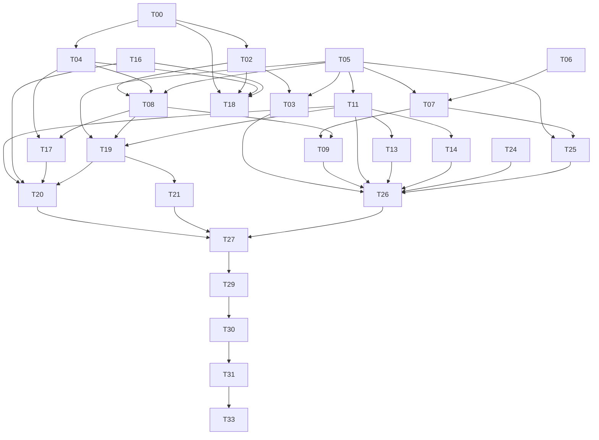

# 集成依赖、条件门禁与并行开发

本图仅包含 26 个有效单元；T01/T10/T12/T15/T22/T23/T28/T32/T34/T35/T36 是合并索引，不是等待节点。边为集成验收依赖，不禁止消费已审合同/fixture 提前开发。G0 是规划审核，不要求运行/生产条件已齐备。

## 修正的依赖

| 原约束 | 现处理 |
| --- | --- |
| T03 等 T11 | 删除。工具不依赖文章 ACL；T26 回滚演练才组合 ACL |
| T14 等 T13/T10 | 删除。AI 消费 StoredArticle，不依赖前端页面/全量对账 |
| T05/T06 等完整 T00 | 删除。核心模型/纯转换按合同和自身版本验证开发 |
| T11 等 T07 | 删除硬前置。用核心模型 fixture 验证读取，T26/T27 验证实际写读组合 |
| T19 等 T16/T17 | 直接 URL 无此依赖；目录/token 输入在 T20 接线验收 |
| T25 等 T03/T14/T19/真实 T24 | 开发仅需 T05/T07 和静态旧入口；生产 apply 在 T29 才检查完整门禁 |
| T26 等 OPML/健康 UI、预先封存 T36 | 删除。候选镜像在 T26 内演练成功后封存；产品完整 UI 在 T27 |
| T35 等 SDK/全部核心模型才建镜像 | 合入 T02，先建轻量 ORM 运行时，Adapter 在 T08 组合验收 |

## 条件集成与运行门禁

- T13 的真实修复依赖 T08，T20 的真实健康依赖 T09；两者均已通过 T26 进入 T27 的闭合路径。UI 单元阶段使用 fixture，不能声称实时引擎通过。
- T17 只返回安全候选时可用现有鉴权；加入文章缓存预览时调用 T11，在 T20 验证。
- T19 基础直接 URL 独立，目录 ID/token 验证分支在 T20 结合 T16/T17；RSSHub 别名执行需要 T18。
- T18 为可选 RSSHub 流。T26/T27/T29 若包含 RSSHub 样本/来源，额外要求 T18 实际通过；native 可先验收。最终保留任何 RSSHub 来源都不能遗漏此门禁。
- T24 副本缺失仅阻塞真实盘点、T26 真实数据演练和生产范围；T25 可继续合成测试。
- T26 没有“封存先于封存测试”的循环：候选→隔离往返演练→封存；最终封存有完整发布 schema 准备门禁，T13/T16/T21 的 DDL 可先于 UI 合入，不把未测后续 schema 包进早期证据。T29 必须已有真实封存基点。
- T29 内先试点后批次，T30 等全部来源处置；T33 内先最终验证后获批发布。实际授权仅阻塞执行阶段。

## 并行与文件协调

| 阶段 | 可并行工作 | 协调点 |
| --- | --- | --- |
| 首组 | T00 / T06 / T16 | 引擎实验、纯函数、目录各自文件；依赖清单串行合并 |
| 核心 | T05 / T04 / T02 中已具合同者 | 核心 migration 与镜像/SDK 可并行，合并时锁版本 |
| 模型后 | T07 / T11 / T08 中依赖满足者 | content_store、access、operations 分模块；共享路由薄接线串行 |
| 产品 | T14 / T13 / T17，或 T19 / T21 / T20 中接口明确部分 | 共用类型先形成公共提交，避免同时改同一组件 |
| 迁移工具 | T25 / T03 / T24 | fence、备份、盘点可独立；实际两库演练串行 |
| 生产 | T29 的逐来源/共享组 | 实际切换串行；记录可共用一份 manifest |

建议最多 3 项并行，限制用于控制冲突/资源，并非共享一个文件就冻结整个任务。schema 编号、公共 API/types、Compose 和依赖清单用串行合并窗口；同一写入算法/迁移脚本的重叠才需要串行开发。测试资源不同可同时运行，实际切源和恢复不并行操作同一库。

## 集成批次

B0 文档一致性；B1 引擎/模型/转换/SDK 专项与契约；B2 同步、ACL、阅读/AI、订阅/发现/OPML 组合全量；G3 的 T26/T27 负责真实迁移与产品；B3 旧栈删除后在最终镜像复验全量、恢复/重启和资源。

同一 SHA/配置/代码范围的有效证据可复用，不在封存和每源工单重复跑完整恢复。失败阻塞受影响集成/上线，无关开发继续。
